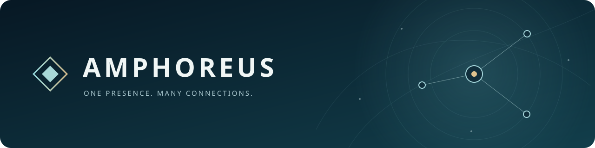
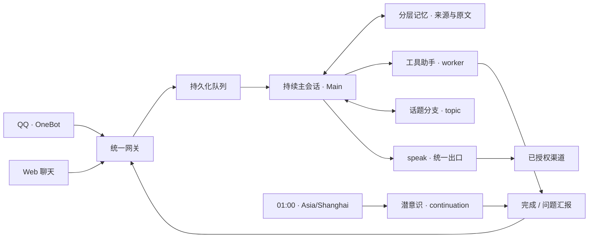

<p align="center">
  
</p>

<h1 align="center">翁法罗斯 · Amphoreus</h1>

<p align="center"><strong>愿此行，终抵群星。</strong><br>基于 DeepSeek Harness 的持续角色运行系统</p>

<p align="center">
  <a href="LICENSE"></a>
  <a href="package.json"></a>
  <a href="https://github.com/deepseek-ai/deepseek-harness"></a>
  
</p>

<p align="center"><a href="#开始使用">开始使用</a> · <a href="#能做些什么">功能</a> · <a href="#消息怎么走">架构</a> · <a href="#继续往里看">文档</a> · <a href="#开源许可">许可</a></p>

---

消息可以来自很多地方，角色仍然是同一个。

翁法罗斯把 QQ、Web 与内部事件接进统一网关，交给一个持续存在的主会话。需要动手的事情交给工具助手，夜间回顾交给潜意识，旧话题交给话题分支；重要的经历留下来源，日记和 Self 经过角色自己审阅后再确认。

会聊天，也能安静地听着。后台忙起来的时候，主会话还可以继续接话——不用陪着一个长任务干等啦。

> **这是运行角色的程序，不是一个预装角色。** 仓库和发布包不携带任何私人 Persona、人设、记忆、聊天记录、日记、作品或图库。你可以为自己的角色准备独立资料，所有分支以同一份核心 Persona 为基准。

## 能做些什么

| 能力 | 实际行为 |
| --- | --- |
| **一个持续主会话** | 所有平台共用 Main；来源标签和权限用于路由，聊天历史不会按平台拆成几个人 |
| **统一消息出口** | `speak` 默认原路回复，也可指定已授权渠道；普通 assistant 文本保留为内部想法 |
| **各做各的后台分支** | worker 执行工具任务，continuation 通过原生 Fork 构思与回顾，topic 分支按需讨论旧话题 |
| **有来源的分层记忆** | 保存经历、发言、想法和身份历史；中文 FTS5 检索、事实有效期与证据关联帮助找回过去，摘要不替换原文 |
| **夜间回顾** | 北京时间 01:00 直接启动潜意识，整理时不占 Main；草稿返回后再由 Main 审阅 |
| **QQ 自主参与** | 心意模式与混合调度可切换；支持总开关、渠道开关和每个群聊/私聊的分开关 |
| **按需多模态** | 图片与 GIF 按顺序进入模型；语音可接 ASR，视频、文件和合并转发默认只给预览 |
| **人物关系与表情图库** | 按稳定账号记录关系和证据；检索、收藏、编辑、导入与导出表情，GIF 保留原始字节 |
| **完整管理界面** | 原生侧栏入口、统一聊天、Subagent 会话、分角色模型配置、用量统计与 CLI 风格日志 |

缓存命中率、回复延迟、上下文填充周期、联网搜索和估算费用均可查看。费用按带日期的价格快照计算，Go 窗口是本程序的观察值，不是供应商账单或全账号余量。

## 消息怎么走



Main 负责交流、调度和审阅；长任务不用占着她的调用栈。夜间调度直接启动潜意识，普通进度留在后台，完成、失败或需要澄清时才唤醒 Main。

工具助手可以读取记忆，独享 dsh-deja 的工具与自动召回。Main、潜意识和话题分支不加载 Deja；检索索引仍可以覆盖这些分支的历史。话题整理器与表情识图请求也单独记账。

## 开始使用

### 先准备宿主

需要兼容的 **DeepSeek Harness Web profile**、已配置的模型提供方，以及符合 [package.json](package.json) 要求的 Node.js。源码构建使用 pnpm 11。

QQ 接入需要独立部署 NapCat / OneBot；不接 QQ，也可以先用 Web。FFmpeg / ffprobe 与 deja 引擎按需安装，不包含在 npm 包中。管理页面面向桌面浏览器与 Android 浏览器。

### 从 npm 发布包安装

发布后的包名为 `@hosisora_ling/dsh-amphoreus`。在已有的 DSH Web profile 中安装，并启用同名业务 bundle：

```sh
dsh plugin --profile amphoreus add @hosisora_ling/dsh-amphoreus
```

尚未发布到 registry 时，可把包名替换为本地 `.tgz` 的绝对路径安装。包内保留构建产物、对应源码、构建配置和完整许可证。内部配置条目仍为 `dsh-amphoreus`，用于接续既有状态，不会新建另一套记忆。

### 从源码安装

```sh
git clone https://github.com/HosisoraLing/amphoreus.git
cd amphoreus
pnpm install --frozen-lockfile
pnpm build

# 在已经创建好的 DSH Web profile 中安装
dsh plugin --profile amphoreus add "link:$PWD"
```

在 profile 中启用翁法罗斯业务 bundle，保留 DSH 的基础与 Web bundle，并按 [profile 配置示例](examples/profile.cordis.patch.yml) 设置独立 `stateDir`，用 `configPath` 或环境变量指定私有角色文件。无需再启用另一套 QQ、人物关系或全局 Deja 插件。

**已有 profile 不要重新初始化或整份覆盖配置。** 完整安装、认证、升级与数据迁移见 [部署指南](docs/009-amphoreus.md)。

### 填好自己的角色配置

将 [配置示例](examples/amphoreus.json) 复制到仓库之外的私有目录，替换占位值。角色、人设、模型选择、工作区和渠道权限都由部署者提供，真实凭证由 DSH 或私有配置管理。

```sh
AMPHOREUS_CONFIG=/absolute/private/amphoreus.json dsh --profile amphoreus
```

启动后，从 DSH 侧栏进入 **翁法罗斯**。嵌入入口为 `/amphoreus/`，独立管理入口为 `/console/`；两者连接同一个角色与数据库。

配置准确的 `api.allowedHosts`，通过受控反向代理提供 HTTPS。QQ 默认关闭，先确认授权范围，再连接真实账号。第一步只要把自己的角色安稳地接进来就好，不必一下子把所有入口都开满。

## 有些边界，先说清楚

- **角色有选择。** 进入网关不等于必须发言；心意模式由角色决定，混合调度会先控制唤醒。关闭的渠道和会话只归档，不在重开后补发。
- **记下来，不等于已经做过。** 候选、想法、工具结果和正式发言分别保留。程序不自动把草稿确认成日记或 Self。
- **失败不假装成功。** 中断的推理和任务保留记录，先核对已完成操作再重试；发送失败可核查、重发，并在配置 SMTP 后告警。
- **模型能力有前提。** 图片、工具和语音效果取决于模型与外部服务。视频、文件及转发详情需要主动读取，不默认展开全部内容。

## 你的数据，留在自己的地方

| 内容 | 存放与边界 |
| --- | --- |
| 程序、通用提示与合成测试 | 本仓库及发布包 |
| 核心 Persona、凭证、渠道权限 | 仓库外的私有配置和 DSH 凭证存储 |
| 记忆、关系、事件、报告、统计 | 独立状态目录与 SQLite |
| 原生 Session、附件、工作成果 | 持久化的 DSH home 与工作区 |
| 个人表情、GIF 与图库索引 | 私有 `amphoreus/memes` 数据目录 |

升级程序时保留这些数据目录。迁移旧数据时生成独立副本、核对内容；不要把运行数据放回源码目录，也不要用公开 issue 传送私人记录。项目许可证只授权程序，不授予任何私有人设或作品的使用权。

## 继续往里看

| 主题 | 文档 |
| --- | --- |
| 安装、启动、升级 | [发布说明](docs/publishing.md) · [部署与运行](docs/009-amphoreus.md) · [独立认证](docs/standalone-auth.md) |
| 记忆、原文与旧数据 | [Memory Foundation](docs/010-memory-foundation.md) · [记忆增强与验证](docs/memory-enhancement.md) · [迁移说明](docs/amphoreus-legacy-import.md) · [话题串](docs/topic-threads.md) |
| 消息、群聊与权限 | [统一发言](docs/amphoreus-speak.md) · [群聊参与](docs/amphoreus-social-presence.md) · [开关](docs/amphoreus-controls.md) · [黑名单](docs/user-blacklist.md) |
| 模型与人际关系 | [分角色模型](docs/amphoreus-models.md) · [人物关系](docs/amphoreus-people.md) |


## 开发与贡献

```sh
pnpm typecheck
pnpm test
pnpm build
# 或 pnpm check
```

优先复用现有 Runtime、原生 Session 与网关。修改消息或任务逻辑时，用临时数据库和模拟传输验证，再按需要进行真实部署验收。测试与示例应始终使用合成角色和占位配置。

欢迎挑错、补实现，也欢迎把它改成适合自己的样子。提交问题时，说明触发方式、期望行为与脱敏后的日志；别把令牌、人设或聊天原文一股脑贴上来呀。

## 开源许可

翁法罗斯新增与修改部分采用 **[GNU Affero General Public License v3.0 only](LICENSE)**，SPDX 标识为 `AGPL-3.0-only`。

使用、修改和再分发应遵守完整许可。通过网络提供修改版服务时，应按 AGPLv3 第 13 条向远程交互用户提供对应源码的获取方式；这不要求公开部署者的凭证或私人角色数据。

项目基于 [DeepSeek Harness Superagent Prototype](https://github.com/deepseek-ai/dsh-superagent-prototype)，保留 [上游 MIT 版权和许可](LICENSES/MIT-upstream.txt)，并非 DeepSeek 官方产品。内嵌 dsh-deja、dsh-meme 及其他组件保留各自许可，详见 [NOTICE](NOTICE)、[第三方说明](THIRD_PARTY_NOTICES.md) 和管理页「关于」。MiSans 字体、NapCat 及其他外部组件不受本项目 AGPL 许可重新授权。
